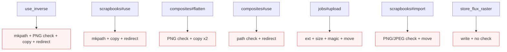
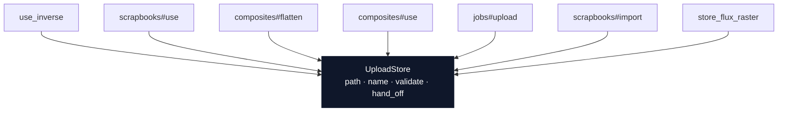
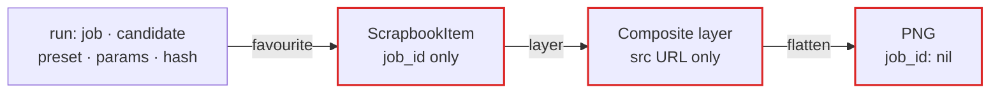
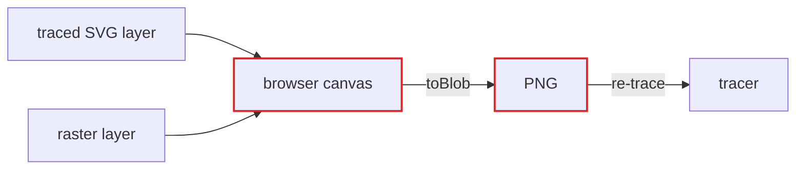
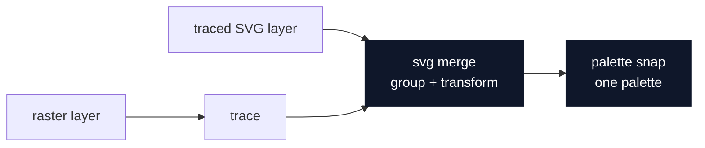

# Architecture review — Scrapbook & Composite

Scope: the composition subsystem — the four most recent commits
(`995c793 → 4497cad`). Everything else in the repo is out of scope.

Legend: **module** = a thing with an interface and an implementation ·
**interface** = everything a caller must know to use it · **seam** = where a
module's interface lives · **adapter** = what satisfies an interface at a seam.
Red arrows mark leakage across a seam.

---

## 1. Give the composite a server-side module — composition lives in a browser script

**Recommendation: Strong** · category: in-process

**Files:** `app/models/composite.rb` · `app/controllers/composites_controller.rb` ·
`app/views/composites/show.html.erb` · `app/javascript/aether.js`

**Problem:** the `Composite` module is a JSON bag — its interface (name, width,
height, background, a layers array) is nearly as complex as its implementation
(a column reader plus one sort). All the depth — placement, paint order,
opacity/hue clamping, flatten — sits in a 564-line view script and the browser
canvas, where the Rails suite never reaches it.

**Solution:** extract a composition module that owns the layer model (placement,
paint order, opacity/hue rules, provenance) and the flatten, so the browser
becomes a view over it instead of the source of truth.

**Before — shallow:**

```
┌───────────────────────────────────┐
│ interface: 7 fields + 3 methods   │  ← nearly as big as the body
├───────────────────────────────────┤
│ implementation: json reader+sort  │  ← thin
└───────────────────────────────────┘
        depth lives in the 564-line view script (untested by Rails)
```

**After — deep:**

```
┌───────────────────────────────────┐
│ interface: place · flatten        │  ← small
├───────────────────────────────────┤
│ placement & paint order           │
│ opacity / hue clamping            │  ← depth absorbed
│ provenance capture                │
│ flatten (vector merge | trace)    │
└───────────────────────────────────┘
```

**Wins**

- locality: composition rules concentrate in one module
- leverage: one interface, exercised by view + runner + tests
- tests stop asserting "redirect happened" and start asserting "the composite came out right"

---

## 2. "Make these bytes an upload" is copy-pasted across four controllers

**Recommendation: Strong** · category: in-process

**Files:** `app/controllers/jobs_controller.rb` · `app/controllers/scrapbooks_controller.rb` ·
`app/controllers/composites_controller.rb`

**Problem:** the invariant "an upload in `storage/uploads` is the only input the
runner reads" is re-implemented by hand at seven call sites — with four separate
magic-byte checks that disagree on range and format.

**Solution:** one module owns upload storage: path, naming, magic-byte
validation, and the new-job hand-off. The seven call sites collapse to one
interface.

**Before — seven hand-rolled copies:**



**After — one deep module:**



**Wins**

- locality: one magic-byte check, not four disagreeing ones
- leverage: one interface, seven call sites
- deletion test: delete the duplication → behaviour concentrates, nothing vanishes

---

## 3. Provenance is dropped at favourite-time and at flatten-time

**Recommendation: Worth exploring** · category: data-model

**Files:** `app/models/scrapbook_item.rb` · `app/models/composite.rb` ·
`app/controllers/scrapbooks_controller.rb` · `db/schema.rb`

**Problem:** the layer list cannot trace back to the run it came from.
`ScrapbookItem` keeps `job_id` but drops candidate, preset, params and source
hash; a composite layer is just a `src` URL, and the flattened PNG is
`kind: "upload", job_id: nil`.

**Solution:** provenance is a first-class part of the artifact record — captured
once at favourite-time, carried through composite → flatten → job.

**Before — provenance leaks away:**



**After — provenance travels:**


**Wins**

- locality: provenance captured once, at the seam where a run becomes an artifact
- enables the layer-list → run trace-back the composition model promises
- no test today asserts provenance survives; there is nothing to test against

---

## 4. Vector layers have no seam — the flatten is the browser's raster

**Recommendation: Strong** · category: ports & adapters

**Files:** `app/views/composites/show.html.erb` (flatten) ·
`app/controllers/composites_controller.rb` · runner contract (chopshop-svg) ·
`scripts/snap_colors.py` (chopshop-svg)

**Problem:** flatten is `ctx.drawImage → toBlob → POST a PNG` — the browser
rasterises every layer, so a traced SVG candidate dropped into a composite is
rasterised and re-traced. The round trip the vector model exists to avoid is
built in at the seam.

**Solution:** flatten becomes an svg merge (group + transform per vector layer)
with a trace only for raster layers, and a palette snap against one palette at
flatten time. The browser posts a layer list, not a PNG.

**Before — forced raster round-trip:**



**After — vectors stay vectors:**



**Wins**

- kills node inflation + antialias-edge noise from the raster round-trip
- palette snap against the whole composite, once — no five-navys-per-layer
- seam sits where the runner contract already is; two adapters (studio, runner) justify it

> Depends on candidate 1: the svg merge needs a server-side composition module
> to live in. Not blocked by any ADR — none exist in this repo.

---

## Top recommendation

**Start with candidate 1, and let 4 land inside it.**

The composition model has no server-side module — that is the root, and the
other three are its symptoms: the upload duplication (2), the lost provenance
(3), and the forced raster round-trip (4) all exist because the browser, not the
application, owns what a composite *is*. Extract the module first; the svg merge
and palette snap from candidate 4 are the first behaviours it should own,
because they are the vector model's whole point and they are cheap once the seam
exists.
